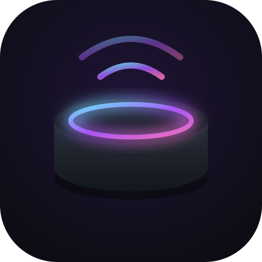
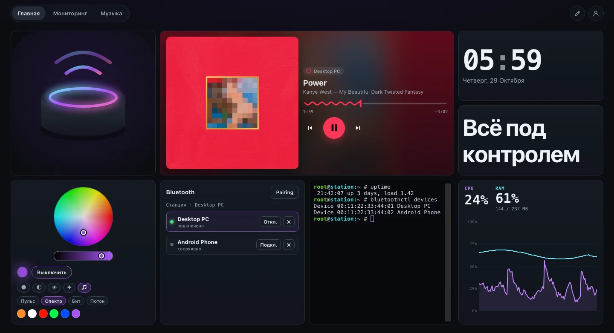
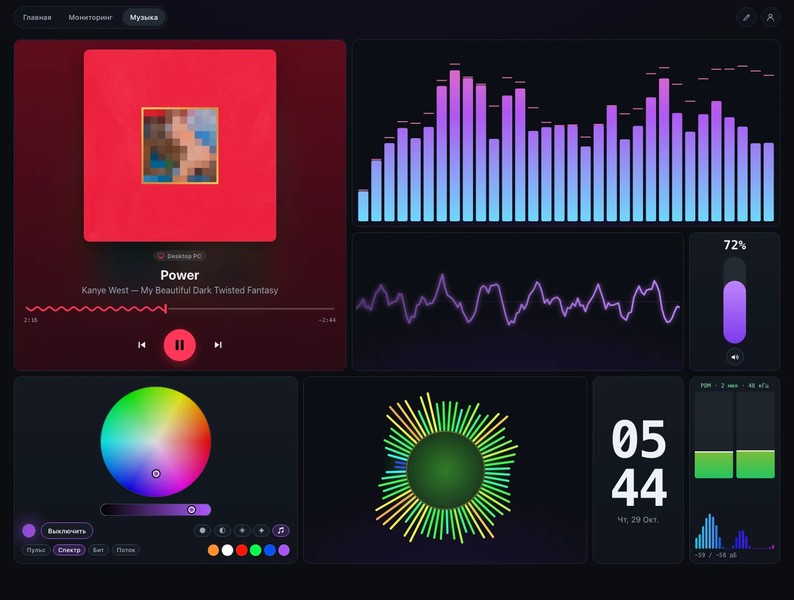
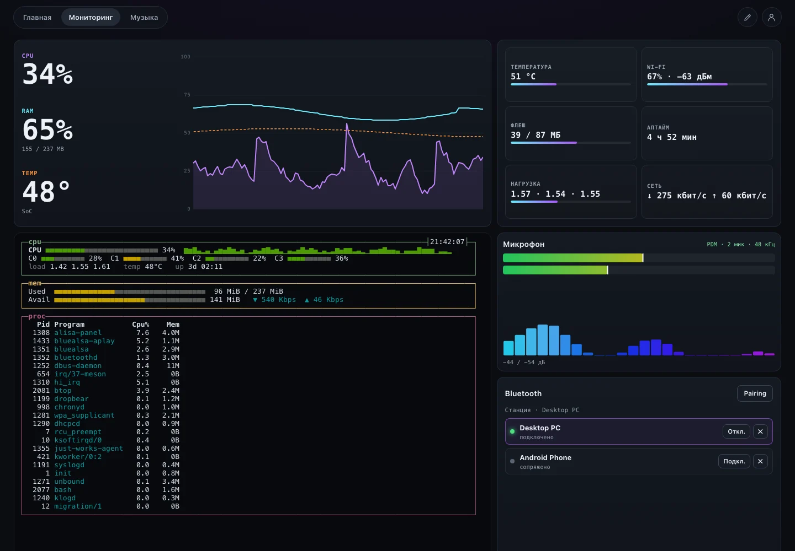
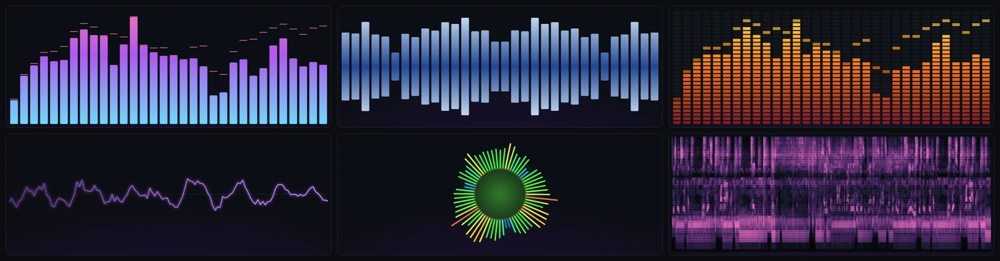
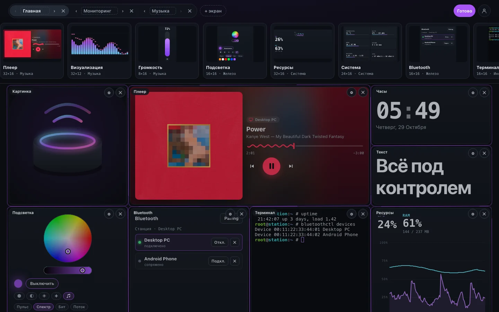
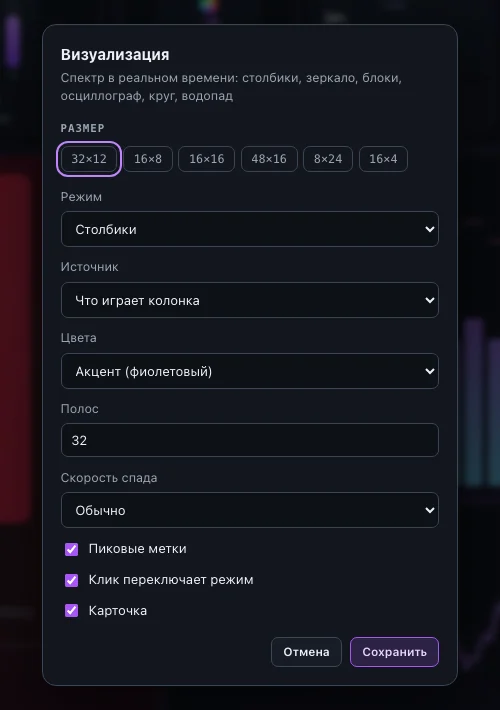
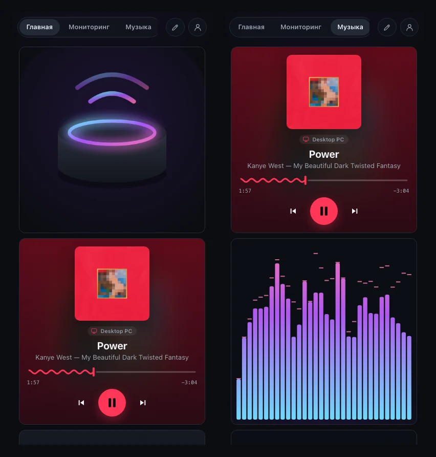
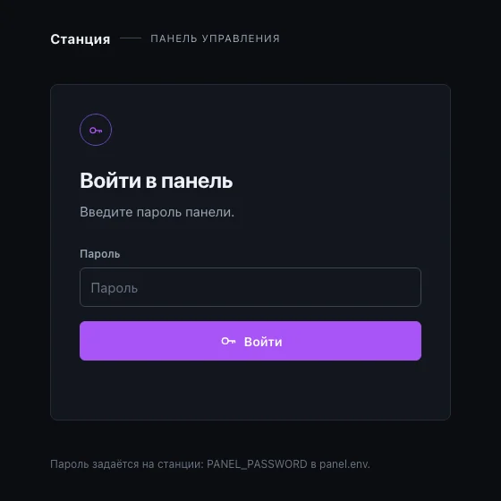

<p align="center">
  
</p>

<h1 align="center">Alisa Control Panel</h1>

<p align="center">
  Домашний экран для рутованной <b>Яндекс Станции Лайт 2</b>, которая живёт без Алисы.<br>
  Плеер, светомузыка, визуализатор, терминал и мониторинг — в браузере телефона или компьютера.
</p>

<p align="center">
  
  
  
  
</p>



## Что внутри

- 🎵 **Плеер** — что играет по Bluetooth с телефона или ПК: обложка, источник, таймлайн, управление
- 🌈 **Визуализатор** в реальном времени — шесть режимов, звук берётся прямо с выхода колонки
- 💡 **Подсветка кольца** — цвет, дыхание, радуга, свеча и светомузыка; работает на станции, даже когда вкладка закрыта
- 🎙 **Микрофоны** — уровни и спектр с PDM-массива, без стека Яндекса
- 🖥 **Терминал** — настоящий root-shell (xterm.js), хоть `btop` на весь экран
- 📊 **Мониторинг**, Bluetooth, громкость, часы, текст, картинки
- 🧩 **Экраны собираете сами**: перетаскивание, ресайз, свайп между экранами; каждый виджет перестраивается под свой размер — от строки до узкой колонки
- 🔐 Вход по **паролю** или **passkey**, HTTP или HTTPS

| | |
|---|---|
|  |  |
| **Музыка** — плеер, визуализаторы, громкость, свет | **Мониторинг** — ресурсы, система, `btop`, микрофон |


<p align="center"><sub>Столбики · зеркало · LED-блоки · осциллограф · круг · водопад</sub></p>

| | |
|---|---|
|  |  |
| Долгое нажатие — режим редактирования и каталог виджетов | У каждого виджета свои настройки |

<p align="center">
  
  &nbsp;
  
</p>

## Быстрый старт

Нужны станция с root по SSH ([hackalice.me](https://hackalice.me)) и Entware, на компьютере — [Zig 0.15.2](https://ziglang.org/download/) и Node.js 20+.

```sh
cp deploy.env.example deploy.env     # HOST=root@<IP станции>
(cd web && npm ci)
scripts/deploy.sh                    # собрать, залить, запустить
```

Впишите пароль в `/data/opt/etc/alisa-panel/panel.env` на станции, `/etc/init.d/S98alisa-panel restart` — и открывайте **`http://<IP станции>:8080`**.

Посмотреть без станции: `cd web && npm run demo && python3 -m http.server -d dist`, затем открыть http://localhost:8000/demo.html.

<details>
<summary><b>HTTPS и passkey</b></summary>

Passkey работает только по HTTPS на доменном имени. Положите сертификат в `/data/opt/etc/alisa-panel/tls/` (`fullchain.pem`, `privkey.pem`) и укажите в `panel.env`:

```sh
PANEL_TLS=on
PANEL_PORT=443
PANEL_AUTH=passkey
PANEL_ORIGIN=https://panel.example.com
```

Первый вход создаёт passkey владельца. Можно и без встроенного TLS: `PANEL_TLS=off` за обратным прокси.
</details>

<details>
<summary><b>Все настройки <code>panel.env</code></b></summary>

| Переменная | По умолчанию | |
|---|---|---|
| `PANEL_NAME` | `Станция` | имя в интерфейсе |
| `PANEL_AUTH` | `passkey` с TLS, иначе `password` | способ входа |
| `PANEL_PASSWORD` | — | пароль, от 8 символов |
| `PANEL_TLS` | `auto` | `on` / `off` / `auto` — включён, если есть сертификат |
| `PANEL_PORT` | `443` / `8080` | порт |
| `PANEL_BIND` | `0.0.0.0` | адрес |
| `PANEL_TLS_CERT`, `PANEL_TLS_KEY` | `tls/fullchain.pem`, `tls/privkey.pem` | сертификат |
| `PANEL_ORIGIN`, `PANEL_RP_ID` | — | адрес и домен для passkey |

Ошибка в настройках не даёт серверу стартовать — причина в логе `/data/opt/etc/alisa-panel/alisa-panel.log`.
</details>

<details>
<summary><b>Что где на станции</b></summary>

| | |
|---|---|
| `/data/opt/bin/alisa-panel` | сервер: один бинарник, интерфейс вшит внутрь |
| `/data/opt/bin/alisa-panel-supervise` | перезапуск при падении, core dump для `scripts/coredump.sh` |
| `/data/opt/bin/alisa-panel-btguard` | сторож Bluetooth-звука — [почему он нужен](docs/bluetooth-audio.md) |
| `/etc/init.d/S98alisa-panel` | автозапуск |
| `/data/opt/etc/alisa-panel/` | настройки, вход, подсветка, сертификаты, лог |
| `/data/opt/share/alisa-panel/assets/` | файлы для `/assets/*`, например `logo.png` для виджета «Картинка» |
</details>

## Свой виджет

Один файл в `web/src/widgets/library/` и одна строка регистрации — каталог, настройки, ресайз и сохранение раскладки подхватят его сами. Пример и описание API — в **[docs/widgets.md](docs/widgets.md)**.

```sh
cd web
npm run watch     # пересборка интерфейса
npm run kit       # web/dist/kit.html — каждый виджет во всех размерах на фейковых данных
npm run demo      # web/dist/demo.html — весь интерфейс без станции
npm run check     # типы
```

## Важно

Терминал — это root на станции. Не выставляйте панель в интернет без входа; снаружи — только HTTPS + passkey или VPN.

Внутри: [passcay](https://github.com/uzyn/passcay) (WebAuthn, MIT), [tls.zig](https://github.com/ianic/tls.zig), [xterm.js](https://xtermjs.org), [GridStack](https://gridstackjs.com), [uPlot](https://github.com/leeoniya/uPlot), [iro.js](https://iro.js.org). Подробности про Bluetooth-звук и macOS — в [docs/bluetooth-audio.md](docs/bluetooth-audio.md).
